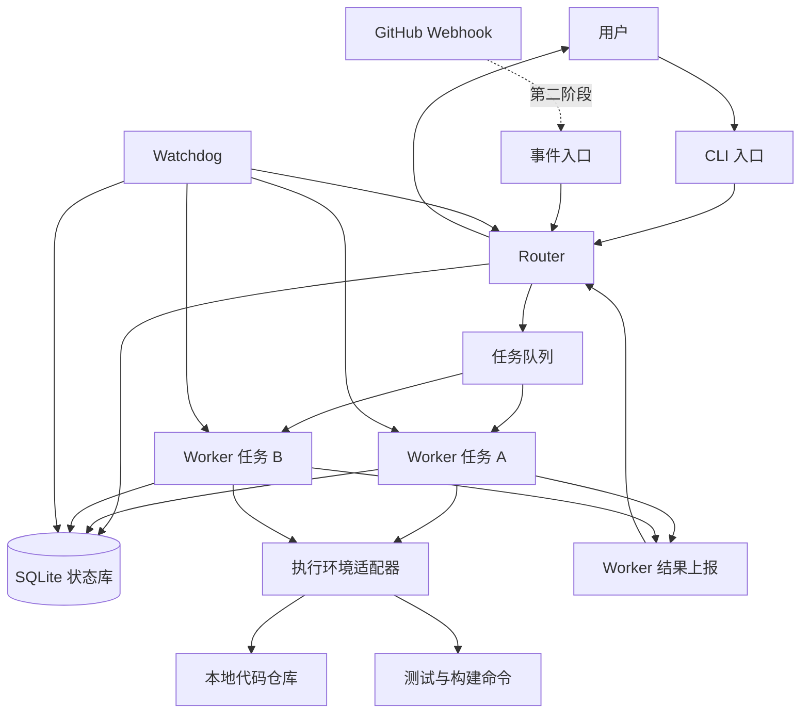
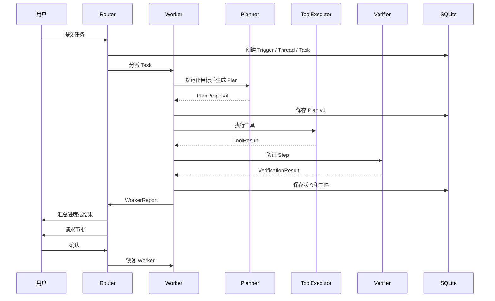

# mySuperAgent 架构文档

## 1. 文档目标

本文定义 mySuperAgent 第一阶段的产品目标与技术架构，为后续实现、拆分任务和评估结果提供共同依据。

第一阶段的产品定位是个人研发助手：用户提交一个需求、Issue、报错或 Pull Request，Agent 在指定代码仓库中分析问题、执行任务、运行验证，并将结果交给用户确认。

本文采用逐步演进的设计。先验证单机环境中的任务闭环，再接入 GitHub 事件和长期运行能力。

## 2. 产品目标

### 2.1 核心工作流

```text
用户输入任务
    -> 创建任务与 Thread
    -> Router 判断任务类型和执行环境
    -> Worker 在隔离上下文中执行
    -> 读取代码、修改文件、运行测试
    -> 汇报计划、Diff、测试结果
    -> 用户确认后推送分支或创建 PR
```

### 2.2 第一阶段成功标准

- 用户可以通过 CLI 提交自然语言任务。
- 每个任务拥有独立的状态、上下文和工作目录。
- Worker 可以读取仓库、修改文件并运行测试命令。
- 任务中断后可以从持久化状态恢复。
- 多个任务可以排队或并行执行，彼此上下文隔离。
- 远程写入动作需要用户明确确认。
- 每个任务都有可追踪的事件记录、执行日志和最终结果。

### 2.3 暂缓范围

以下能力放到后续阶段：

- 微信、飞书、Telegram 等多渠道接入。
- 云端常驻部署和跨设备执行环境。
- 多 Worker 之间的复杂协作。
- 大规模长期记忆和链式召回优化。
- 自动合并代码、删除资源或修改生产环境。
- 基于模型的复杂投机执行。

## 3. 总体架构



系统分为五个逻辑层：

1. **入口层**：接收 CLI 输入和后续的外部事件。
2. **Router 层**：维护全局任务视图，识别 Thread，决定任务分派和用户回复。
3. **Worker 层**：在独立上下文中完成具体任务，并将结构化结果上报给 Router。
4. **执行环境层**：封装文件、Shell、Git 和测试命令。
5. **状态与控制层**：持久化任务状态，并通过 Watchdog 处理超时与恢复。

## 4. 核心组件

### 4.1 入口层

第一阶段提供 CLI：

```bash
superagent task "修复登录接口的超时问题，运行相关测试"
superagent task list
superagent task show <task-id>
superagent task approve <task-id>
superagent task cancel <task-id>
```

入口层负责参数校验、身份识别和事件创建。它不直接执行代码任务。

后续 GitHub Webhook 进入系统后，会被转换成统一的 Trigger 对象，再交给 Router 处理。

### 4.2 Router

Router 是常驻的全局协调组件，职责包括：

- 接收新的用户消息和环境事件。
- 根据来源、仓库、Issue、PR 或任务 ID 查找 Thread。
- 创建新任务，或将事件追加到已有任务。
- 选择执行环境和 Worker 配置。
- 向 Worker 发送任务指令。
- 接收 Worker 的进度、结果和阻塞信息。
- 汇总 Worker 状态，并生成面向用户的简洁回复。
- 处理需要用户决定的审批节点。

Router 负责所有对外交互。具体代码修改、测试执行和长时间命令均交给 Worker；Worker 的输出先转换为结构化报告，再由 Router 汇总后回复用户。

### 4.3 Worker

每个 Worker 对应一个可追踪的任务上下文，职责包括：

- 获取任务描述和关联 Thread。
- 检查仓库状态，创建独立工作目录或分支。
- 读取相关代码和配置。
- 形成执行计划。
- 调用文件、Shell、Git 和测试工具。
- 保存关键步骤和中间结果。
- 汇报进度、阻塞原因、Diff 和验证结果。

Worker 不直接向用户发送消息。它通过任务事件或结果报告向 Router 上报，报告至少包含当前状态、已完成步骤、待处理问题、生成的 Artifact 和下一步建议。

Worker 的执行状态使用有限状态机管理：

```text
queued -> running -> waiting_approval -> completed
                  |                  -> failed
                  |                  -> cancelled
                  -> paused
```

### 4.4 执行环境适配器

执行环境适配器隔离 Agent 逻辑与本机工具，第一阶段提供：

- `FileSystem`：读取、写入和列出工作目录内的文件。
- `Shell`：执行允许的命令，记录退出码、输出和耗时。
- `Git`：查看状态、创建分支、生成 Diff、提交变更。
- `TestRunner`：按仓库配置执行测试和构建命令。

适配器需要统一返回结构化结果，至少包含：

```json
{
  "ok": true,
  "exit_code": 0,
  "stdout": "...",
  "stderr": "...",
  "duration_ms": 1234
}
```

### 4.5 状态存储

第一阶段使用 SQLite。状态存储负责保存任务生命周期、事件、执行步骤和审批记录。

后续需要更高并发时，可以将队列迁移到 Redis 或其他消息系统，将持久化状态迁移到 PostgreSQL，业务接口保持稳定。

### 4.6 Watchdog

Watchdog 以定时任务运行，检查：

- Worker 是否超过执行时限。
- 任务状态是否长时间没有变化。
- 进程是否退出但任务仍处于运行状态。
- 工作目录是否存在未记录的变更。
- 重试次数是否超过上限。

Watchdog 的处理顺序：记录异常、尝试恢复、继续观察；恢复失败后将任务标记为 `failed`，再由 Router 通知用户。

### 4.7 Agent Loop 详细设计

Agent Loop 运行在 Worker 内部，负责将一个 Task 从用户目标推进到可验证结果。Loop Controller 负责状态转换、预算检查和恢复边界；模型负责提出计划、选择工具和生成重新规划建议。

#### 4.7.1 模块职责

```text
TaskNormalizer
    -> Planner
    -> LoopController
    -> ContextBuilder
    -> ToolExecutor
    -> Verifier
    -> ReportBuilder
```

- `TaskNormalizer`：将用户输入转换为目标、范围、验收条件、风险等级和执行环境。
- `Planner`：根据任务契约生成或修改结构化 Plan。
- `LoopController`：驱动循环，管理 Plan、Step、预算、租约和状态转换。
- `ContextBuilder`：装配当前步骤需要的任务、计划、历史摘要和工具结果。
- `ToolExecutor`：校验并执行注册工具，管理同步与异步 Run。
- `Verifier`：执行步骤对应的确定性检查，并在需要时请求模型进行语义判断。
- `ReportBuilder`：生成给 Router 的结构化 WorkerReport。

#### 4.7.2 执行阶段

每轮循环按以下阶段推进：

```text
Observe -> Plan / Select -> Act -> Verify -> Report -> Next
```

1. **Observe**：读取任务状态、Plan 版本、工作目录快照、Git 状态、活动 Run 和最近事件。
2. **Plan / Select**：生成初始计划，或从 Ready Queue 中选择下一步；环境变化和失败证据会触发重新规划。
3. **Act**：执行一个副作用工具，或批量执行明确独立的只读工具。
4. **Verify**：执行 Step 的验证器，保存验证证据。
5. **Report**：向 Router 上报进度、结果、阻塞原因、Artifact 和下一步建议。
6. **Next**：进入下一步、等待审批、请求用户介入、暂停、失败或完成。

#### 4.7.3 Loop Controller 伪代码

```python
async def run_task(task_id: str) -> None:
    lease = await task_store.acquire_lease(task_id)
    if lease is None:
        return

    try:
        while True:
            await budget_guard.check(task_id)
            task = await task_store.load(task_id)
            await task_store.heartbeat(task_id, lease)

            if task.status in {"cancelled", "completed", "failed"}:
                return

            snapshot = await context_builder.observe(task)

            if planner.needs_initial_plan(task, snapshot):
                contract = await normalizer.normalize(task.instruction, snapshot)
                proposal = await planner.create_plan(contract, snapshot)
                await controller.accept_plan(task.id, proposal)
                continue

            if controller.should_replan(task, snapshot):
                context = await context_builder.build_for_replan(task, snapshot)
                proposal = await planner.revise_plan(context)
                await controller.accept_plan_patch(task.id, proposal)
                continue

            step = controller.select_ready_step(task.plan)
            if step is None:
                decision = await controller.resolve_no_ready_step(task)
                await controller.apply_decision(task.id, decision)
                continue

            context = await context_builder.build(task, step, snapshot)
            decision = await planner.select_action(context)
            await controller.validate_decision(task, step, decision)

            if decision.type == "call_tool":
                run = await tool_executor.start(task, step, decision.tool_call)
                await controller.record_run_started(task.id, step.id, run)

                if run.is_async:
                    await controller.wait_for_tool_event(task.id, run.id)
                    continue

                result = await tool_executor.finish(run)
                await controller.record_run_finished(task.id, step.id, result)
                verification = await verifier.verify(task, step, result)
                await controller.apply_verification(task.id, step.id, verification)

            elif decision.type == "request_approval":
                await controller.enter_approval(task.id, step.id, decision.request)

            elif decision.type in {"patch_plan", "ask_user", "report_progress", "finish"}:
                await controller.apply_decision(task.id, decision)

            report = await report_builder.build(task.id)
            await router_reporter.publish(report)

    except BudgetExceeded as error:
        await controller.block(task_id, reason=str(error))
        await router_reporter.publish(await report_builder.build(task_id))
    except Exception as error:
        await controller.handle_unexpected_error(task_id, error)
        await router_reporter.publish(await report_builder.build(task_id))
    finally:
        await task_store.release_lease(task_id, lease)
```

模型输出只允许使用结构化决策类型：

```text
call_tool
patch_plan
request_verification
request_approval
report_progress
ask_user
finish
```

模型输出先经过 JSON Schema 校验，再交给 Loop Controller 执行。`reasoning_summary` 只保存面向调试和汇报的简短摘要，不保存隐藏推理过程。

#### 4.7.4 Plan 与 Step Schema

```json
{
  "plan_id": "plan-123",
  "task_id": "task-123",
  "version": 2,
  "goal": "修复登录接口的超时问题",
  "acceptance_criteria": [
    "相关单元测试通过",
    "超时场景返回明确错误",
    "Diff 只涉及登录模块"
  ],
  "risk_level": "workspace_write",
  "budget": {
    "max_steps": 20,
    "max_replans": 3,
    "max_wall_time_minutes": 30
  },
  "steps": [
    {
      "id": "step-01",
      "objective": "定位登录请求的超时处理逻辑",
      "dependencies": [],
      "inputs": ["src/auth"],
      "actions": ["读取相关文件", "搜索超时配置"],
      "expected_outputs": ["相关文件列表", "当前超时处理说明"],
      "verifier": {"type": "evidence_present"},
      "retry_policy": {"max_attempts": 2},
      "status": "succeeded"
    },
    {
      "id": "step-02",
      "objective": "实现超时错误处理",
      "dependencies": ["step-01"],
      "inputs": ["step-01.result"],
      "actions": ["修改文件", "运行相关测试"],
      "expected_outputs": ["代码 Diff", "测试报告"],
      "verifier": {"type": "command", "command": "pytest tests/auth"},
      "retry_policy": {"max_attempts": 3},
      "status": "ready"
    }
  ]
}
```

已验证成功的 Step 保持不可变。未开始的 Step 可以在新 Plan 版本中修改；正在运行的 Step 先完成或取消，再应用计划变更。

#### 4.7.5 状态转换

```text
Task:
queued -> running -> waiting_approval -> running -> completed
                  |                  -> blocked
                  |                  -> paused
                  |                  -> failed
                  -> cancelled

Step:
pending -> ready -> running -> verifying -> succeeded
                         |              -> failed
                         |              -> blocked
                         -> cancelled
pending -------------------------------> skipped
```

状态转换只能由 Loop Controller 产生，并在同一事务中写入状态快照和事件记录。

#### 4.7.6 工具调用协议

工具必须注册以下元数据：

```json
{
  "name": "shell.run",
  "input_schema": {
    "type": "object",
    "required": ["command"],
    "properties": {"command": {"type": "string"}}
  },
  "permission": "workspace_write",
  "timeout_seconds": 120,
  "retry_policy": {"max_attempts": 2},
  "result_schema": "CommandResult"
}
```

每次调用生成唯一的 `run_id` 和 `idempotency_key`，并保存：参数摘要、工作目录、权限级别、启动时间、结束时间、退出码、标准输出、标准错误和结果摘要。

#### 4.7.7 WorkerReport 协议

```json
{
  "task_id": "task-123",
  "run_id": "run-789",
  "sequence": 12,
  "event_type": "step_completed",
  "status": "running",
  "plan_version": 2,
  "step_id": "step-02",
  "summary": "已完成代码修改，测试仍在执行",
  "artifacts": ["diff-456"],
  "blocking_reason": null,
  "next_action": "等待测试结果",
  "created_at": "2026-11-18T12:00:00Z"
}
```

Router 按 `task_id + sequence` 处理报告，重复报告直接确认并跳过，乱序报告进入等待队列。

#### 4.7.8 审批协议

Worker 遇到远程写入或高风险动作时生成审批请求：

```json
{
  "task_id": "task-123",
  "step_id": "step-03",
  "action": "git.push",
  "risk_level": "remote_write",
  "impact": "将分支 feature/login-timeout 推送到 origin",
  "diff_summary": "修改 2 个文件，新增 18 行，删除 4 行",
  "options": ["approve", "reject", "request_changes"],
  "expires_at": "2026-11-18T12:30:00Z"
}
```

Router 将请求转换为用户消息并保存审批结果。确认后恢复原 Worker；拒绝后将步骤标记为 `cancelled` 或 `blocked`，由 Router 汇报后续状态。

#### 4.7.9 预算与租约

第一阶段默认预算：

```yaml
task:
  max_wall_time_minutes: 30
  max_steps: 20
  max_replans: 3
  max_model_tokens: 100000

step:
  max_attempts: 3
  max_wall_time_minutes: 10

tool:
  default_timeout_seconds: 120
```

Worker 获取带过期时间的 Task Lease，并通过心跳续租。进程退出、心跳超时或租约过期后，Watchdog 将任务恢复为 `queued` 或 `failed`。恢复时先检查最近的工具调用结果和 Step 检查点，再决定继续、重试或重新规划。

#### 4.7.10 失败处理矩阵

| 失败类型 | 示例 | 默认动作 | 后续状态 |
| --- | --- | --- | --- |
| 可重试 | 网络抖动、临时进程退出 | 退避后重试 | `running` |
| 可修复 | 测试失败、参数错误、代码错误 | 将证据交给模型生成修复动作 | `running` |
| 需要用户介入 | 需求冲突、权限不足、审批超时 | Router 请求用户决定 | `blocked` |
| 不可恢复 | 工作目录损坏、关键依赖缺失 | 保存现场并结束执行 | `failed` |
| 预算超限 | 步骤、时间或模型预算耗尽 | 停止新动作并汇报原因 | `blocked` |

连续出现同类失败时，Controller 增加失败计数并触发重新规划；达到任务预算后停止自动尝试。

#### 4.7.11 典型时序



#### 4.7.12 第一阶段实现顺序

1. 实现 `Plan`、`Step`、`Run`、`WorkerReport` 数据结构和 SQLite 表。
2. 实现 Loop Controller 的状态转换和预算检查。
3. 实现 `FileSystem`、`Shell`、`Git`、`TestRunner` 工具注册与执行。
4. 实现 Planner 的结构化输出和 Schema 校验。
5. 实现 Verifier、失败分类、重试和重新规划。
6. 实现 WorkerReport、Router 汇总和审批恢复。
7. 实现 Lease、心跳、Watchdog 和进程重启恢复。
8. 使用真实代码仓库完成端到端任务验证。

#### 4.7.13 Router / Worker 接口契约

Router 与 Worker 之间采用事件和报告交互，双方不共享模型上下文。

```python
class RouterWorkerBridge(Protocol):
    async def dispatch(self, task_id: str) -> None:
        """将任务放入 Worker 队列。"""

    async def publish_report(self, report: WorkerReport) -> None:
        """接收 Worker 的有序报告。"""

    async def publish_event(self, task_id: str, event: Trigger) -> None:
        """向任务追加用户或环境事件。"""

    async def request_resume(self, task_id: str, approval_id: str) -> None:
        """审批完成后恢复对应 Worker。"""


class WorkerRuntime(Protocol):
    async def start(self, task_id: str) -> None:
        """获取租约并启动 Agent Loop。"""

    async def resume(self, task_id: str, event_id: str | None = None) -> None:
        """从检查点或新事件继续执行。"""

    async def cancel(self, task_id: str, reason: str) -> None:
        """停止接收新动作，终止当前 Run 并保存现场。"""

    async def status(self, task_id: str) -> WorkerReport:
        """返回当前任务的结构化状态。"""
```

内部模块接口保持数据导向：

```python
class Planner(Protocol):
    async def create_plan(self, contract: TaskContract, context: Context) -> PlanProposal: ...
    async def revise_plan(self, context: ReplanContext) -> PlanProposal: ...
    async def select_action(self, context: StepContext) -> Decision: ...


class ToolExecutor(Protocol):
    async def start(self, task: Task, step: Step, call: ToolCall) -> ToolRun: ...
    async def finish(self, run: ToolRun) -> ToolResult: ...
    async def stop(self, run_id: str, reason: str) -> None: ...


class Verifier(Protocol):
    async def verify(self, task: Task, step: Step, result: ToolResult) -> VerificationResult: ...
```

接口实现需要遵守以下约束：

- 所有写操作先生成事件，再更新当前状态快照。
- 所有异步操作都返回可追踪的 ID。
- 所有报告都携带任务 ID、计划版本和序列号。
- Router 负责跨任务协调，Worker 负责单任务执行。
- 模型输出只能通过 Controller 转换成状态变化或工具调用。

## 5. 领域模型

### 5.1 Trigger

Trigger 表示进入系统的一次外部事件。

| 字段 | 说明 |
| --- | --- |
| `id` | 全局唯一 ID |
| `source` | `cli`、`github`、`scheduler` |
| `type` | `user_message`、`issue`、`pull_request`、`ci_result` |
| `thread_id` | 关联 Thread，可为空 |
| `payload` | 原始事件内容 |
| `created_at` | 创建时间 |

### 5.2 Thread

Thread 表示围绕同一个对象形成的连续事件流，例如一个 Issue、一个 PR 或一次 CLI 任务。

| 字段 | 说明 |
| --- | --- |
| `id` | Thread ID |
| `kind` | `task`、`issue`、`pull_request` |
| `external_key` | 外部对象标识 |
| `repository` | 仓库路径或远程地址 |
| `status` | `active`、`closed` |
| `created_at` | 创建时间 |
| `updated_at` | 最近更新时间 |

### 5.3 Task

Task 表示用户希望系统完成的一项工作。

| 字段 | 说明 |
| --- | --- |
| `id` | Task ID |
| `thread_id` | 所属 Thread |
| `title` | 任务标题 |
| `instruction` | 用户原始要求 |
| `status` | Worker 状态 |
| `workspace` | 工作目录 |
| `branch` | Git 分支 |
| `risk_level` | `read_only`、`workspace_write`、`remote_write` |
| `created_at` | 创建时间 |
| `updated_at` | 最近更新时间 |

### 5.4 Run 与 Artifact

`Run` 表示一次 Worker 执行过程，保存模型调用、工具调用、命令输出和错误信息。

`Artifact` 表示任务生成的结果，例如计划、Diff、测试报告、提交记录或 PR URL。

所有结果都关联 Task，便于恢复、审计和向用户展示。

## 6. 事件处理流程

### 6.1 新任务

1. CLI 创建 `Trigger`。
2. Router 根据仓库和输入内容创建 `Thread` 与 `Task`。
3. Router 检查执行环境和权限。
4. Worker 进入 `queued` 状态并等待调度。
5. Worker 创建独立工作目录，读取任务上下文。
6. Worker 执行计划中的工具调用。
7. Worker 写入中间结果并定期汇报进度。
8. Router 将结果转换成用户可读的摘要。

### 6.2 后续事件

同一 Thread 的后续消息直接追加到原任务。Router 根据当前状态决定：

- 继续当前 Worker。
- 暂停当前 Worker 并等待用户决定。
- 创建新的 Worker。
- 关闭 Thread。

### 6.3 审批流程

任务按风险级别控制权限：

| 风险级别 | 默认能力 | 用户操作 |
| --- | --- | --- |
| `read_only` | 读取文件、分析代码、运行只读命令 | 自动执行 |
| `workspace_write` | 修改工作目录、创建本地分支 | 默认允许，结果需确认 |
| `remote_write` | 推送分支、创建或更新 PR | 每次明确确认 |

## 7. 并发与恢复

第一阶段使用任务队列控制并发：

- Router 负责快速接收事件，避免等待 Worker 完成。
- 每个 Worker 维护独立上下文。
- 同一任务同一时刻只允许一个活动 Run。
- 不同任务可以并行，最大并发数由配置控制。
- 长时间命令使用异步执行，并保存进程 ID 和启动时间。
- 进程重启后，Watchdog 将 `running` 状态的任务恢复为 `queued` 或 `failed`。

任务恢复依赖持久化的事件和步骤记录。Worker 每完成一个可恢复步骤就写入检查点，恢复时从最近检查点继续。

## 8. 安全设计

- 工作目录限制在配置的仓库根目录或其临时副本内。
- Shell 命令经过允许列表、工作目录和超时校验。
- 环境变量和凭据默认不进入模型上下文。
- 远程写入、删除文件和高风险命令需要审批。
- 每次工具调用保存调用者、参数摘要、结果和时间。
- 外部事件中的文本只作为数据处理，系统提示和权限规则保持独立。
- 每个任务拥有独立工作目录，避免多个 Worker 互相覆盖文件。

## 9. 可观测性

每个 Task 至少需要展示：

- 当前状态和最近一次状态变化。
- 当前 Worker 正在执行的步骤。
- 最近一次工具调用和命令结果。
- 已修改文件和 Git Diff 摘要。
- 测试命令、退出码和失败输出。
- 重试次数、耗时和异常原因。

第一阶段使用结构化日志和 SQLite 查询满足排障需求，后续再接入指标和分布式追踪系统。

## 10. 分阶段实现计划

### Milestone 1：单任务闭环

- CLI 命令。
- SQLite 表结构和迁移。
- Router、Worker 基础接口。
- 文件读取、Shell、Git 工具。
- 任务状态和执行日志。
- 计划、Diff、测试结果输出。

### Milestone 2：多任务与恢复

- 任务队列。
- 独立工作目录。
- 异步命令执行。
- Watchdog。
- 进程重启恢复。

### Milestone 3：GitHub 事件

- Webhook 接收器。
- Issue、PR、CI 事件转换为 Trigger。
- Thread 关联和事件去重。
- PR 评论中的状态回复。

### Milestone 4：长期运行能力

- 云端 Router。
- 本地执行 daemon。
- 多设备执行环境。
- 权限管理、密钥代理和更完整的审计。

## 11. 关键决策

### 决策一：先做研发场景

研发任务拥有清晰的输入、输出和验证方式，适合验证 Router、Worker、事件和恢复机制。

### 决策二：先使用 CLI

CLI 的协议和调试成本较低，适合快速验证核心执行链路。GitHub、IM 等渠道作为事件适配器加入。

### 决策三：先使用 SQLite

单用户和低并发场景下，SQLite 可以同时提供持久化、查询和事务能力，迁移成本可控。

### 决策四：审批优先

系统先帮助用户分析、修改和验证，远程副作用由用户确认后触发。这样可以快速积累真实任务数据，并逐步放宽自动化范围。

## 12. 待确认配置

开始实现前需要确定以下默认配置：

- 默认代码仓库路径。
- 使用的模型服务及 API 配置方式。
- 默认测试命令。
- Worker 最大并发数。
- 单个命令和单个任务的超时时间。
- 是否允许 Worker 修改工作目录。
- GitHub 接入使用个人 Token 还是 GitHub App。

